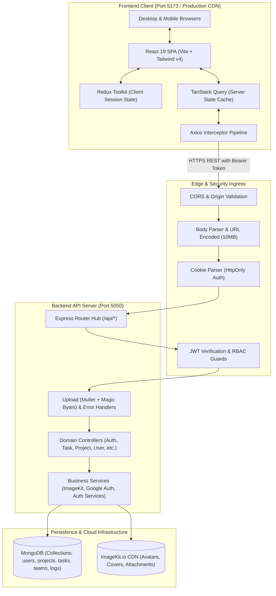
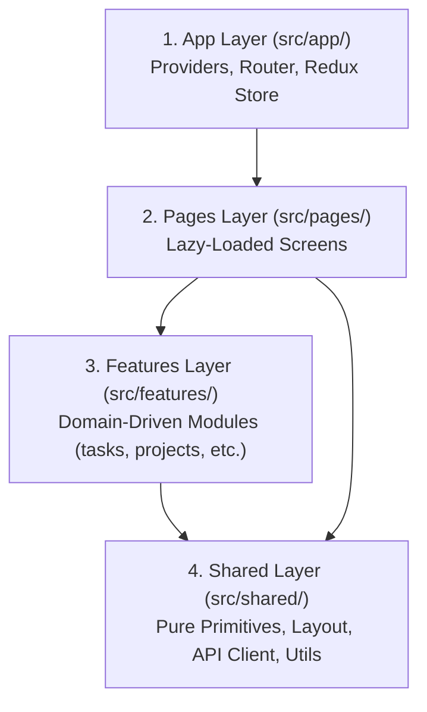
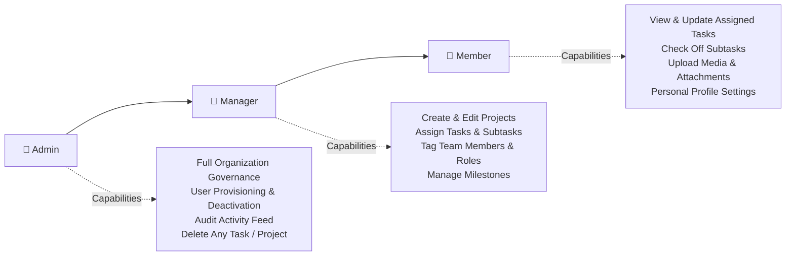

# 🚀 AgentraTeam — Enterprise Task & Collaboration Platform

> **Full-Stack Architectural & Implementation Guidebook**  
> _Engineered for Developers, Technical Leads, and AI Autonomous Agents._  
> **Status:** Production Ready | **Frontend:** React 19 + Vite + Tailwind CSS v4 | **Backend:** Express + Node.js + MongoDB + ImageKit

---

## 🧭 Executive Summary & Core Mission

**AgentraTeam** is a high-performance, full-stack enterprise project management and team collaboration web application. It synthesizes the fluid, keyboard-friendly speed of **Linear**, the structured clarity and context of **Notion**, and the governance, security, and granular Role-Based Access Control (RBAC) of **Jira**.

The application is built on a **fully decoupled monorepo architecture** featuring:

- **Frontend SPA:** Modern React 19 single-page app utilizing Vite, Tailwind CSS v4, Redux Toolkit, TanStack Query v5, and dynamic route-level code splitting.
- **Backend API:** Production-grade Node.js / Express REST API backed by MongoDB / Mongoose, JWT authentication with HttpOnly refresh cookies, Google OAuth, ImageKit media CDN integration, and real-time collaboration readiness.
- **Visual Design System:** Inspired by the **OCTOM Design System** on Figma, characterized by soft ambient shadows, pill-shaped controls, translucent gradients, and strict viewport containment.

---

## 🏛️ High-Level System Architecture



---

## 📁 Repository Directory Map

```text
team-sync/
├── Backend/                              # Express.js REST API Server
│   ├── src/
│   │   ├── app/
│   │   │   └── app.js                    # Express app initialization, CORS, routes & error middlewares
│   │   ├── config/
│   │   │   ├── config.js                 # Central environment configuration & fallbacks
│   │   │   ├── db.js                     # MongoDB Mongoose connection handler
│   │   │   └── imagekit.js               # ImageKit SDK client instance
│   │   ├── controllers/                  # HTTP request controllers (auth, user, task, project, admin, etc.)
│   │   ├── middlewares/                  # Auth, RBAC, magic-bytes upload inspection, error handlers
│   │   ├── models/                       # Mongoose schemas (User, Task, Project, Team, AuditLog, etc.)
│   │   ├── routes/                       # Express routers mounted at /api/*
│   │   ├── services/                     # Business logic (ImageKit service, Auth service, Google OAuth)
│   │   ├── utils/                        # JWT generator, crypto helpers, validation
│   │   └── server.js                     # Server entry point (starts listener on PORT)
│   ├── tests/                            # Unit & integration test suites (Node.js test runner)
│   ├── .env.example                      # Backend environment variable template
│   └── package.json                      # Backend dependencies & test scripts
│
├── Frontend/                             # React 19 Client SPA
│   ├── public/                           # Static assets, brand logos, Google icon
│   ├── src/                              # 4-Tier Architecture
│   │   ├── app/                          # 1️⃣ APP LAYER: AppRouter, Providers, Redux Store
│   │   ├── pages/                        # 2️⃣ PRESENTATION LAYER: Lazy-loaded route screens
│   │   ├── features/                     # 3️⃣ FEATURE LAYER: Domain-driven slices (auth, tasks, projects, etc.)
│   │   ├── shared/                       # 4️⃣ SHARED LAYER: UI primitives, layout, API client, utils
│   │   ├── config/                       # Client runtime environment configuration
│   │   ├── styles/                       # Tailwind CSS v4 globals
│   │   ├── App.jsx & main.jsx            # Application bootstrap
│   │   └── index.css                     # Tailwind root styles
│   ├── vite.config.js                    # Vite bundler configuration
│   └── package.json                      # Frontend dependencies & build scripts
│
├── doc/                                  # Comprehensive System Documentation
│   ├── .ARCHITECTURE.md                  # System architecture, topology & data flow
│   ├── PRD.md                            # Product requirements, personas & acceptance criteria
│   ├── DESIGN.md                         # UI/UX design specifications & component tokens
│   ├── IMAGEKIT_MEDIA_SERVICE.md         # ImageKit integration, 2-phase rollback & upload pipeline
│   └── TASK.md                           # Production optimization & performance audit log
│
└── README.md                             # 📍 Root Guidebook (this document)
```

---

## 🚦 Quick Start Guide

### 1. Prerequisites

- **Node.js:** `v20.x` or higher recommended (compatible with Node 18+)
- **MongoDB:** Local instance running on `mongodb://localhost:27017` or a MongoDB Atlas cluster URI
- **ImageKit Account (Optional for Local Media):** API keys from [ImageKit.io](https://imagekit.io)

---

### 2. Backend Setup

```bash
# Navigate to the backend directory
cd Backend

# Install dependencies
npm install

# Configure environment variables
cp .env.example .env
```

#### Backend Environment Variables (`Backend/.env`):

```env
PORT=5050
NODE_ENV=development
CLIENT_URL=http://localhost:5173
MONGO_URI=mongodb://localhost:27017/team-sync

# Authentication Secrets
ACCESS_TOKEN_SECRET=your_jwt_access_secret_key_here
REFRESH_TOKEN_SECRET=your_jwt_refresh_secret_key_here
ACCESS_TOKEN_EXPIRES_IN=15m
REFRESH_TOKEN_EXPIRES_IN=7d

# ImageKit Configuration (from ImageKit Dashboard)
IMAGEKIT_PRIVATE_KEY=private_xxxxxxxxxxxxxxxxxxxxxxx=
IMAGEKIT_PUBLIC_KEY=public_xxxxxxxxxxxxxxxxxxxxxxx=
IMAGEKIT_URL_ENDPOINT=https://ik.imagekit.io/your_endpoint_id

# Upload Constraints (Bytes, default 5MB)
MAX_FILE_SIZE_BYTES=5242880
```

#### Run Backend Server:

```bash
# Development mode with hot-reloading (nodemon)
npm run dev

# Production run
npm start

# Run unit and integration tests
npm test
```

The backend starts at **`http://localhost:5050`**. Health check: `http://localhost:5050/api/health`.

---

### 3. Frontend Setup

```bash
# Navigate to the frontend directory
cd Frontend

# Install dependencies
npm install
```

#### Frontend Environment Variables (`Frontend/.env` - Optional):

```env
VITE_API_BASE_URL=http://localhost:5050/api
VITE_APP_NAME=AgentraTeam
VITE_GOOGLE_CLIENT_ID=579849600986-538stk5hoe6gij2b43806eajvgsqeprf.apps.googleusercontent.com
```

#### Run Frontend Development Server:

```bash
# Start Vite development server
npm run dev
```

The frontend SPA opens at **`http://localhost:5173`**.

#### Build Frontend for Production:

```bash
npm run build
```

Creates an optimized production bundle inside `Frontend/dist/` with on-demand code chunks.

---

## 🏗️ 4-Tier Frontend Architecture (`Frontend/src/`)

To preserve modularity, enforce separation of concerns, and eliminate circular dependencies, the frontend enforces a strict **downward-only dependency flow**:

$$\text{App Layer} \longrightarrow \text{Pages Layer} \longrightarrow \text{Features Layer} \longrightarrow \text{Shared Layer}$$



### Layer Responsibilities & Strict Invariants:

| Layer           | Directory       | Permitted Responsibilities                                                                                                                                                                            | Forbidden Patterns (Invariants)                                                                                        |
| :-------------- | :-------------- | :---------------------------------------------------------------------------------------------------------------------------------------------------------------------------------------------------- | :--------------------------------------------------------------------------------------------------------------------- |
| **1️⃣ App**      | `src/app/`      | Global store (`store.js`), Top-level router (`AppRouter.jsx`), Global Context Providers (`AppProviders.jsx`).                                                                                         | ❌ No business logic, no domain UI, no feature-specific state.                                                         |
| **2️⃣ Pages**    | `src/pages/`    | Route-bound presentation views (e.g. `TasksPage`, `ProjectDetailsPage`, `AdminDashboardPage`). Connects feature modules to page layouts.                                                              | ❌ No direct Axios calls, no manipulating raw Redux store without domain hooks.                                        |
| **3️⃣ Features** | `src/features/` | Domain modules (`auth`, `tasks`, `projects`, `team`, `admin`, `notifications`, `files`, `messages`, `timeline`, `profile`). Each contains `components/`, `hooks/`, `services/`, and `store/`.         | ❌ Never import across peer features directly. Always coordinate through shared services or parent page orchestrators. |
| **4️⃣ Shared**   | `src/shared/`   | Reusable atomic UI (`Button`, `Modal`, `EmptyState`, `Badge`, `Avatar`, `ProgressBar`), layout templates (`MainLayout`, `Sidebar`, `Navbar`), API client (`apiClient.js`), formatters, and constants. | ❌ **Strictly agnostic.** Must NEVER import anything from `features/`, `pages/`, or `app/`.                            |

---

## 🔐 Authentication, Authorization & RBAC Pipeline

### 1. Token Lifecycles & Security

- **Access Token:** Short-lived JWT stored in memory via Redux Toolkit (`authSlice.js`). Transmitted via `Authorization: Bearer <token>` on all API requests.
- **Refresh Token:** Long-lived JWT stored in an `HttpOnly`, `SameSite=Strict`, `Secure` browser cookie to protect against XSS.
- **Axios Silent Refresh Interceptor:** Automatically catches `401 Unauthorized` responses, invokes `/api/auth/refresh`, updates the Redux token in-flight, and replays failed queries seamlessly.
- **Security-First Password Reset:** Prevents user enumeration by returning uniform success messages regardless of email existence.

### 2. Role-Based Access Control (RBAC)

The application enforces a 3-tier role hierarchy enforced on both server endpoints and client routing:



---

## 📦 Data Models & Schema Design (Mongoose)

### 1. `User` Schema

- `name`, `email` (unique, lowercase), `password` (bcrypt salted hash, cost 10)
- `role`: `['admin', 'manager', 'member']` (default: `'member'`)
- `status`: `['active', 'deactivated']` (default: `'active'`)
- `avatar`: ImageKit CDN URL; `avatarFileId`: ImageKit file ID for safe deletions
- `jobTitle`, `department`, `phoneNumber`, `location`, `timezone`, `bio`, `twoFactorEnabled`
- `googleId`: Optional OAuth provider identifier

### 2. `Project` Schema

- `title`, `key` (e.g. `SYNC-`), `description`, `category` (`Software`, `Design`, `Marketing`, `Operations`)
- `status`: `['planning', 'active', 'on_hold', 'completed', 'archived']`
- `priority`: `['low', 'medium', 'high', 'urgent']`
- `manager`: Ref to `User`
- `members`: Array of tagged contributors with custom roles (`Frontend`, `Backend`, `Designer`, `QA`, `Lead`, `DevOps`)
- `coverImage`, `coverImageFileId`: ImageKit media metadata
- `startDate`, `endDate`, `budget`, `tags`

### 3. `Task` Schema

- `title`, `description`, `project` (Ref to `Project`)
- `status`: `['todo', 'in_progress', 'review', 'done']`
- `priority`: `['low', 'medium', 'high', 'urgent']`
- `assignees`: Array of `User` refs
- `subtasks`: Array of `{ title: String, completed: Boolean, id: String }`
- `progress`: Number (auto-calculated from subtask completion percentage: $0\% - 100\%$)
- `dueDate`, `tags`: Array of strings (e.g. `["#Design", "#v2.0"]`)
- `attachments`: Array of `{ url, fileId, name, size, mimeType, fileType, uploadedAt }`

### 4. Auxiliary Schemas

- `Team`: Team grouping, leader, members list, logo & logoFileId.
- `Comment`: Task comment threads, author ref, text, attachments.
- `Notification`: Target user, sender, type (`task_assigned`, `mention`, `system`), read status.
- `AuditLog`: Action tracking (`CREATE`, `UPDATE`, `DELETE`, `LOGIN`), actor, resource, metadata.

---

## 🖼️ Production ImageKit Media Pipeline

Media management adheres to a **Two-Phase Commit and Rollback Pattern** (`doc/IMAGEKIT_MEDIA_SERVICE.md`):

1. **Binary Magic Bytes Validation:** Uploaded buffers are inspected for true binary magic byte signatures (preventing renamed `.exe` files disguised as `.png`).
2. **Decoupled Upload Execution:** Files are uploaded directly to ImageKit cloud under scoped folder structures (`/profiles`, `/teams`, `/projects`, `/attachments`).
3. **Database Synchronization:** The MongoDB document is updated with `{ url, fileId }`.
4. **Automatic Rollback:** If the database write fails or times out, the newly uploaded ImageKit asset is immediately destroyed (`safeCleanupFile`) to prevent orphaned storage.
5. **Smooth Simulated Progress & Abort Control:** File uploads track simulated percentage increments with a $90\%$ soft ceiling until the server responds, and support immediate client abort via `AbortController`.

---

## ⚡ Performance & Optimization Benchmarks

The codebase has undergone deep production optimization documented in `doc/TASK.md`:

### 1. Dynamic Bundle Splitting (Vite)

- **Problem:** Monolithic single bundle previously forced users to download all 16 page screens upfront (742 kB).
- **Solution:** Converted all route views in `AppRouter.jsx` to dynamic `React.lazy()` imports with safe export wrappers and branded `<PageLoadingFallback />`.
- **Result:** Main client bundle reduced to **419 kB** (145 kB gzipped). The `AdminDashboardPage` chunk (73 kB) is isolated and downloaded exclusively by authenticated administrators.

### 2. Request Deduplication & In-Flight Caching

- **Problem:** Child components re-triggering simultaneous `GET /api/tasks`, `GET /api/projects`, and `GET /api/users` requests on startup.
- **Solution:** Implemented memory cache validation and in-flight request deduplication across custom hooks (`useTasks`, `useProjects`, `useTeam`, `useNotifications`).
- **Result:** Eager request cascades eliminated; subsequent navigation renders cached data instantaneously.

### 3. Dummy Data Cleansing & Unified Empty States

- Removed all static hardcoded mock arrays across `taskSlice.js`, `RecentFilesTable.jsx`, `ChatSidebar.jsx`, and `TimelineCalendarGrid.jsx`.
- Standardized on the reusable `<EmptyState />` UI primitive with contextual icons, explanations, and CTA triggers.

### 4. UI Visual Hierarchy Redesign

- `CreateTaskForm.jsx` and `TaskDetails.jsx` explicitly partition:
  - **Hero Primary Task Title:** Prominent header with distinct "PRIMARY TASK" badge.
  - **Subordinate Checklist:** Nested subtask items with live progress percentage indicators.
  - **Metadata Tags:** Amber pill badges (`#Metadata`) clearly separated from system statuses.
  - **Assignee Selector:** Multi-select popover with avatar chips and role tags.

---

## 📡 API Specification & Standard Response Envelope

All API endpoints follow a consistent RFC-compliant response envelope:

### Success Response:

```json
{
  "success": true,
  "data": { ... },
  "message": "Resource retrieved successfully",
  "meta": {
    "page": 1,
    "limit": 20,
    "totalCount": 85
  }
}
```

### Error Response:

```json
{
  "success": false,
  "message": "Validation failed: 'title' is a required field.",
  "errors": [{ "field": "title", "issue": "Field cannot be empty" }],
  "stack": null
}
```

### Core API Endpoint Reference:

| Method   | Endpoint                     | Auth / Guard        | Description                                            |
| :------- | :--------------------------- | :------------------ | :----------------------------------------------------- |
| `POST`   | `/api/auth/register`         | Public              | Register a new user account                            |
| `POST`   | `/api/auth/login`            | Public              | Authenticate with email/password, sets HttpOnly cookie |
| `POST`   | `/api/auth/google`           | Public              | Google OAuth token exchange                            |
| `POST`   | `/api/auth/refresh`          | Public (Cookie)     | Re-issue expired JWT access token                      |
| `POST`   | `/api/auth/logout`           | Authenticated       | Invalidate refresh session and clear cookie            |
| `GET`    | `/api/users/me`              | `protect`           | Fetch current authenticated user profile               |
| `PATCH`  | `/api/users/profile`         | `protect`           | Update user personal details and settings              |
| `PATCH`  | `/api/users/profile/image`   | `protect` + Multer  | Upload or replace user profile avatar                  |
| `GET`    | `/api/projects`              | `protect`           | List accessible projects with filters                  |
| `POST`   | `/api/projects`              | `protect` + Manager | Create new project with key and assigned members       |
| `GET`    | `/api/projects/:id`          | `protect`           | Fetch project details, members, and progress           |
| `GET`    | `/api/tasks`                 | `protect`           | List tasks (filterable by status, project, assignee)   |
| `POST`   | `/api/tasks`                 | `protect`           | Create task with subtasks, assignees, and tags         |
| `PATCH`  | `/api/tasks/:id`             | `protect`           | Update task status, priority, or subtasks              |
| `DELETE` | `/api/tasks/:id`             | `protect`           | Delete task (owner, manager, or admin)                 |
| `POST`   | `/api/tasks/:id/attachments` | `protect` + Multer  | Upload attachments with 2-phase commit                 |
| `GET`    | `/api/admin/metrics`         | `protect` + Admin   | Fetch organization telemetry and KPIs                  |
| `GET`    | `/api/admin/users`           | `protect` + Admin   | Directory of all users with status toggle controls     |
| `GET`    | `/api/admin/audit-logs`      | `protect` + Admin   | Chronological system audit activity feed               |

---

## 🤖 Invariants & Guidelines for Other AI Agents

When implementing new features, refactoring, or extending this repository, **every autonomous agent must comply with these architectural invariants**:

1. **Respect Frontend Layer Boundaries:**
   - Dependency flow must remain strictly: `app` $\rightarrow$ `pages` $\rightarrow$ `features` $\rightarrow$ `shared`.
   - Never import a peer feature directly (e.g. do not import from `features/tasks` into `features/projects`). Instead, pass data through parent page containers or shared utilities.
   - Never import anything from `features`, `pages`, or `app` into `shared`.
2. **Preserve Dynamic Route Splitting:**
   - Any newly created route view in `Frontend/src/pages/` must be imported via `safeLazy()` in `AppRouter.jsx`.
   - Never use direct static imports for pages in `AppRouter.jsx`.
3. **Zero Mock Data Injection:**
   - Do not commit hardcoded dummy data arrays in Redux slices or page views. Use live endpoints with Redux/TanStack Query and provide `<EmptyState />` fallbacks when collections are empty.
4. **Observe Viewport & Modal Safety:**
   - All modal dialogs and overlay drawers must strictly maintain `max-h-[85vh]` with internal scrolling (`overflow-y-auto`) and a persistent sticky header to prevent viewport overflow on standard laptops and mobile devices.
5. **Enforce ImageKit Two-Phase Rollback:**
   - When touching media or attachments, always preserve the two-phase commit pattern: upload asset $\rightarrow$ write to MongoDB $\rightarrow$ on database error, invoke `safeCleanupFile()` to delete the uploaded cloud asset.
6. **Guard Endpoints on Both Tiers:**
   - Backend routes must be defended with `protect` and appropriate role guards (`requireAdmin`, `authorizeRoles`).
   - Frontend routes must be protected using `<ProtectedRoute allowedRoles={[...]} />`.
7. **Verification Gate:**
   - Before completing tasks, always execute:
     - `cd Backend && npm test`
     - `cd Frontend && npm run build` (must exit with code `0`).

---

## 📚 Documentation Index (`doc/`)

For in-depth specifications, consult the dedicated documentation files:

- [`.ARCHITECTURE.md`](file:///d:/Web%20Devlapment/Cohot_3.0/Projects/team-sync/doc/.ARCHITECTURE.md): Comprehensive system topology, WebSocket engine, Dockerization blueprint, and database indexing.
- [`PRD.md`](file:///d:/Web%20Devlapment/Cohot_3.0/Projects/team-sync/doc/PRD.md): Product requirements document, user personas, MoSCoW prioritization, and acceptance criteria.
- [`DESIGN.md`](file:///d:/Web%20Devlapment/Cohot_3.0/Projects/team-sync/doc/DESIGN.md): Visual design specifications, color tokens, typography scales, and component definitions.
- [`IMAGEKIT_MEDIA_SERVICE.md`](file:///d:/Web%20Devlapment/Cohot_3.0/Projects/team-sync/doc/IMAGEKIT_MEDIA_SERVICE.md): Deep-dive into ImageKit cloud CDN integration, magic bytes detection, and transactional rollback mechanisms.
- [`TASK.md`](file:///d:/Web%20Devlapment/Cohot_3.0/Projects/team-sync/doc/TASK.md): Production audit log detailing bundle optimization, API deduplication, and UI hierarchy redesign.

---

_Maintained by the AgentraTeam Core Architecture Team. Built for seamless collaboration between human engineers and autonomous coding agents._
